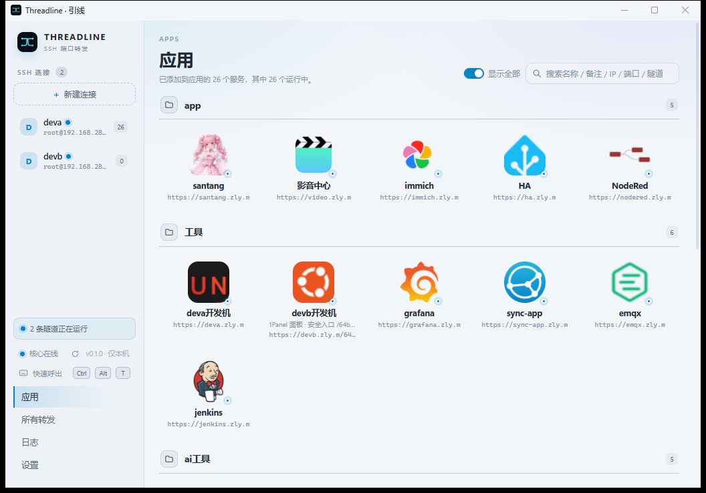
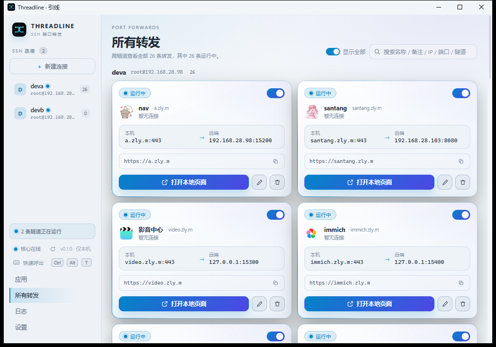
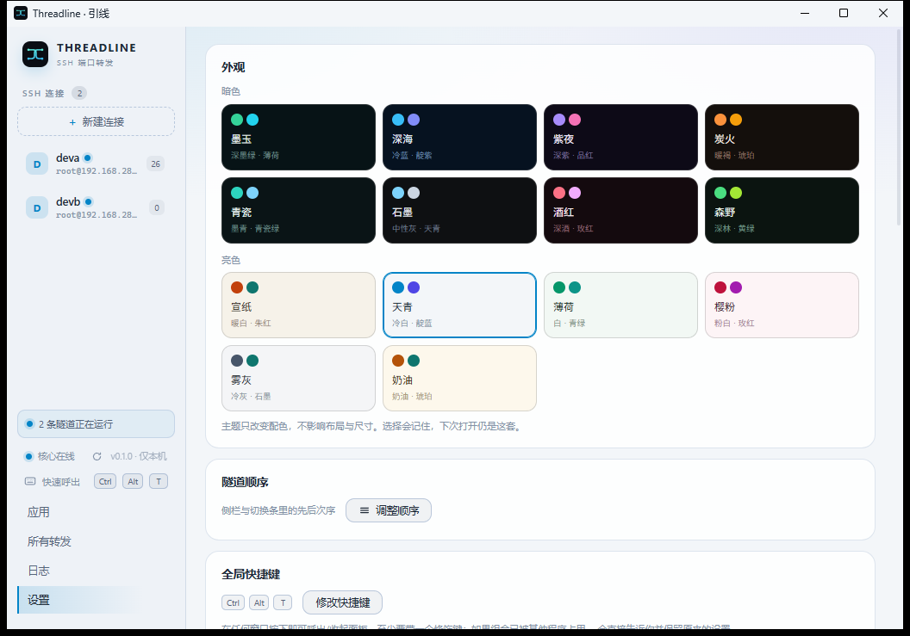

# Threadline

**Turn a service on a remote machine into a local port or a local domain.**

[](LICENSE)
[](#requirements)
[](https://github.com/zlyuancn/Threadline/releases)

> The installer is **not code-signed**, so SmartScreen shows "Unknown publisher" on first run — click "More info → Run anyway". Verify against `SHA256SUMS.txt` first.



*26 forwards running at once. One SSH session per tunnel, shared by its forwards; icons come from site favicons.*

[中文文档](README.md)

---

## What it is for

**Reach an internal panel.** Your Home Assistant, router and NAS have no public entry point. With Threadline, `https://ha.example.com` opens locally, served by a locally signed certificate, so the browser stays quiet.

**Reach a database.** Production only accepts connections from a bastion host. Open one forward and `127.0.0.1:5432` is that database — point Navicat or DBeaver at `localhost` as usual.

**Reach a dev box.** `ssh -L` means retyping seven parameters, reconnecting after every drop, and three terminals for three services. Threadline stores them, opens on one click, reconnects by itself.

---

## Features

| | |
|---|---|
| **Parallel tunnels** | One SSH session per tunnel, started and stopped independently |
| **Auto-reconnect** | Backoff reconnect; the set of forwards that were running comes back by itself |
| **Domain access** | Each forward can get a `127.0.0.2–254` loopback entry, resolved through a managed hosts block |
| **Local gateway CA** | HTTPS handled per the "local scheme × remote scheme" grid: plaintext pass-through, local termination, or end-to-end passthrough |
| **Apps page** | Forwards grouped into tiles, icons pulled from site favicons, full-text search |
| **Autostart** | One switch; with it on, tunnels work before anyone logs in (SYSTEM scheduled task) |
| **Global hotkey** | `Ctrl+Alt+T` summons the panel; rebindable |
| **Plain TCP** | RDP, SSH, MySQL, Redis — just port forwarding with different default ports |

Local forwarding only (`-L`). **No** remote forwarding (`-R`), **no** SOCKS5 (`-D`).



*Each card reads "this local entry → that remote service", with a one-click domain entry.*

The look is swappable: 16 light/dark themes that only change colours, never layout — and your pick survives a restart.



---

## Quick start

1. Download `Threadline_x.y.z_x64-setup.exe` from [Releases](https://github.com/zlyuancn/Threadline/releases) and install.
2. Open **Threadline**, click *New connection*, fill in host, port, user and credential.
3. On first connect you are asked to verify the host key fingerprint — **trust it only if it matches what `ssh` shows in your terminal**.
4. Click *New forward*: remote `127.0.0.1:8123` (Home Assistant, say), local `127.0.0.1:8123`.
5. Open <http://127.0.0.1:8123>. Want a domain instead? Fill in *Access domain* — hosts is written on save when the core already has rights, otherwise click **Write hosts** on the banner.

---

## What it changes on your system

This is the only place you need to read before trusting it.

| Action | What changes | When | Admin required |
|---|---|---|---|
| SSH connection | Outbound only, nothing written | When a tunnel starts | No |
| Domain access | One managed block in `C:\Windows\System32\drivers\etc\hosts` (`# >>> threadline domain access (managed) >>>`) | Clicking **Write hosts** on the in-app banner | **Yes** (one UAC) |
| HTTPS for domains | A `Threadline Local Gateway CA` root installed into the **current user's** trusted root store | *Install CA* in settings | No (`HKCU`) |
| Domain access | Domain appended to `HKCU\...\Internet Settings\ProxyOverride` (existing entries preserved) | Clicking **Sync** on the in-app banner | No (`HKCU` only) |
| Autostart | Scheduled task `ThreadlineCore` (SYSTEM) + `HKCU\...\Run\Threadline` | Toggling the switch | **Yes** (one UAC) |

Everything lives in `%PUBLIC%\Threadline`:

| File | Contents |
|---|---|
| `servers.json` / `tunnels.json` | Connection and forward config (no passwords) |
| `credentials.dat` | Credentials (DPAPI machine scope) |
| `control.json` | Control-plane port and token (rotated each start) |
| `gateway-ca\` | Local CA root and private key |
| `logs\agent.log` | Agent-side log |

> **Other accounts on the same machine can read and write this directory.** Threadline targets **single-user machines**; do not use it on a shared PC — see [SECURITY.md](SECURITY.md).

---

## Clean uninstall

The installer removes program files only. To remove the rest:

```powershell
# 1. Scheduled task
schtasks /delete /tn ThreadlineCore /f
# 2. Logon entry
reg delete "HKCU\Software\Microsoft\Windows\CurrentVersion\Run" /v Threadline /f
# 3. Root certificate: certmgr.msc → Trusted Root CAs → delete "Threadline Local Gateway CA"
# 4. hosts: delete the block between # >>> threadline domain access (managed) >>> and its end marker
# 5. Data directory (credentials and CA key live here)
Remove-Item -Recurse -Force "$env:PUBLIC\Threadline"
```

---

## Versus `ssh -L`

| | `ssh -L` | Threadline |
|---|---|---|
| Setup | Type flags or edit `~/.ssh/config` | Store in UI, one click |
| Many at once | Several terminals / several `-L` | One panel, independent switches |
| Connection drop | Session ends, port disappears | Reconnects and restores forwards |
| Domain + HTTPS | Hand-rolled hosts and certificates | Managed hosts block + local CA |
| Autostart | Write a service / scheduled task | One switch |
| Dependency | System OpenSSH | Bundled SSH implementation |

---

## Architecture

Two processes, plus one orchestration library compiled into the agent:

```
┌──────────────────┐   HTTP + Bearer token    ┌──────────────┐
│     tl-agent     │ ───────────────────────► │   tl-core    │
│    tray / UI     │   127.0.0.1:18921-19020  │ tunnels      │
│ (bundles tl-wake)│                          └──────┬───────┘
└──────────────────┘                                 │ SSH
                                                     ▼
                                              ┌──────────────┐
                                              │  remote sshd │
                                              └──────────────┘
```

- **`tl-core`** — headless daemon owning SSH sessions, forwarding listeners, hosts sync and the local CA. Can be started as SYSTEM so tunnels work before login.
- **`tl-agent`** — Tauri 2 shell: tray and UI only, a pure client of the control API.
- **`tl-wake`** — **not a process**: a small library compiled into `tl-agent` that starts a user-scoped core when the registered one is missing.

Layering is enforced by `tools/msocheck`: `foundation` (system calls) / `models` (state and rules) / `business` (orchestration) / `interface` (HTTP adapters). `models` may not touch Win32, read files, or make network calls.

---

## Build from source

**Requirements**: Windows 10 1809+ / 11, Rust stable (`Cargo.toml` declares 1.80 as the floor, but it is not version-by-version verified — just use the latest stable), Node ≥ 22.12, pnpm 9 (pinned via `packageManager`), WebView2 Runtime.

```powershell
git clone https://github.com/zlyuancn/Threadline.git
cd Threadline

rustup component add rustfmt clippy
pnpm install

pnpm build                      # frontend assets (embedded at compile time)
cargo build --release -p tl-core # prebuild rebuilds this anyway; run once to confirm it compiles
pnpm tauri build                # installer → src-tauri/target/release/bundle/nsis/
                                # prebuild: rebuild release core → stage sidecar → pnpm build
```

During development:

```powershell
cargo test --workspace          # core tests
.\scripts\verify.ps1            # full local gate (must be green before commit; stages sidecar + dist itself)
```

> **`pnpm dev` does not work on its own**: it only serves vite. Every request still needs a running core plus a token, which in dev mode is read from `localStorage` (`tl.token`) — there is no UI to paste one. To see the desktop window, run `pnpm build` → `cd src-tauri; cargo build` → restart `Threadline.exe`. `tauri dev` has no `devUrl`, so there is no hot reload.
>
> **Running agent tests alone** needs two compile-time artifacts first: `pnpm build` (creates `dist/`) and `scripts/bundle-sidecars.ps1` (creates `binaries/tl-core-*.exe`); otherwise `tauri-build` fails outright. `verify.ps1` does both for you.

---

## FAQ

**Corporate AV/EDR blocks outbound?** Some suites cut off unsigned binaries (symptom: an HTTP 403 gateway page). Whitelist the install directory.

**"Unknown publisher" on launch?** Expected — no code signature. Check `SHA256SUMS.txt`, then *More info → Run anyway*.

**hosts write failed?** It needs one UAC prompt. If you cancel, a "pending elevation" banner appears; sync again.

**Port already in use?** Pick another local port, or click the dice for a free one.

**Where are the logs?** `%PUBLIC%\Threadline\logs\agent.log`. Core logs are not yet written to disk, so the in-app log page may stay empty.

**What is left after uninstall?** See the five steps above.

---

## Security and privacy

- No telemetry, no accounts, no cloud: everything stays on this machine.
- The control plane binds `127.0.0.1` only, rotates a 32-byte random token every start, and requires `Authorization: Bearer`.
- Credentials and the CA private key are DPAPI-encrypted at rest.
- Privileged entry points (hosts sync, ACL repair, autostart) accept only a fixed data-directory constant, never a caller-supplied path.
- The local CA issues leaves for managed domains only; the root carries `pathlen:0`.

Known limitations and the vulnerability channel are in [SECURITY.md](SECURITY.md). **Shared machines are out of scope.**

---

## License

Source is released under [**PolyForm Noncommercial 1.0.0**](LICENSE):

- ✅ Free for personal use, research, study, hobby projects, and noncommercial organizations (charity, education, public research, government); modification and redistribution allowed;
- ✅ Redistribution must keep the `Required Notice` line (attribution) and these terms;
- ❌ **Commercial use requires a separate license** (including internal production use at a company). Contact the author.

This is not an OSI-approved license; GitHub labels it `Other`. Third-party notices: [THIRD_PARTY-NOTICES.md](THIRD_PARTY-NOTICES.md).

---

## Credits

- [Tauri](https://tauri.app/), [Vue](https://vuejs.org/), [Element Plus](https://element-plus.org/) — shell and UI
- [russh](https://github.com/Eugeny/russh), [rustls](https://github.com/rustls/rustls), [rcgen](https://github.com/rustls/rcgen) — SSH and TLS
- Inspired by `ssh -L` and by joyshare's separation of entry and origin
