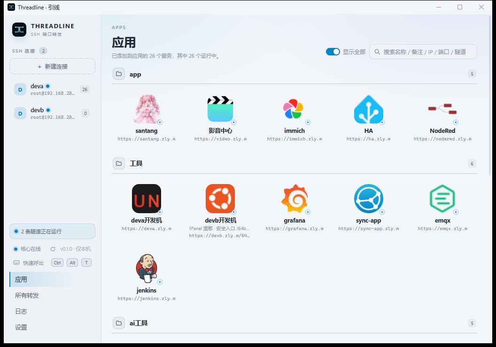
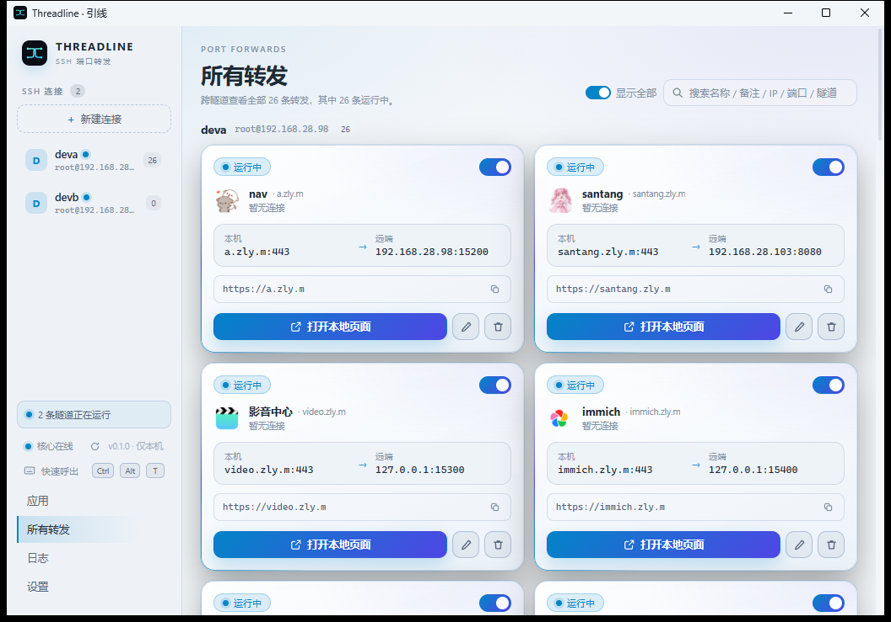
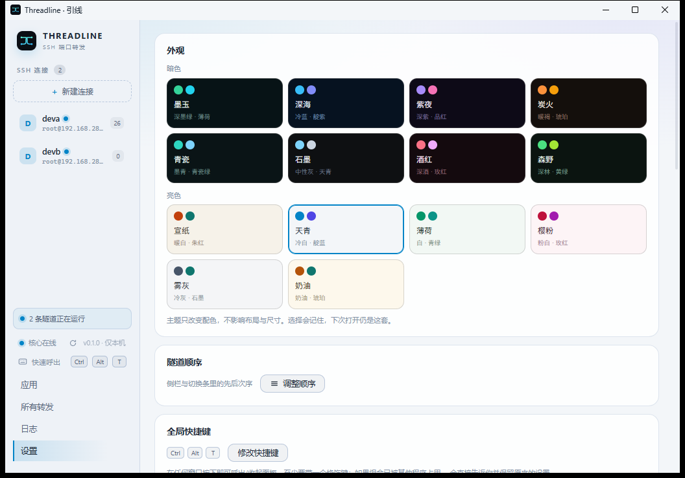

# Threadline · 引线

**把远端的服务，变成你本机的一个端口或一个域名。**

[](LICENSE)
[](#从源码构建)
[](https://github.com/zlyuancn/Threadline/releases)

> 首次运行会被 SmartScreen 拦成「未知发布者」——安装包没有代码签名，点「更多信息 → 仍要运行」即可。请先用 `SHA256SUMS.txt` 核对文件。



*26 条转发同时在跑。每条隧道一条独立 SSH 会话，转发共用它；图标自动取自站点 favicon。*

---

## 它解决什么问题

**连内网面板**：家里的 Home Assistant、路由器、NAS 都在内网，没有公网入口。用 Threadline 后，本机 `https://ha.example.com` 直接打开，证书是本地签的，浏览器不报警。

**连数据库**：生产库只允许从跳板机访问。开一条转发，本机 `127.0.0.1:5432` 就是那个库，Navicat / DBeaver 照常填 `localhost`。

**连开发机**：`ssh -L` 每次要手敲七八个参数、断了要重连、开三个服务就是三行命令。Threadline 把这些存下来，点一下就开，断了自动重连。

---

## 功能

| | |
|---|---|
| **多隧道并行** | 每条隧道一条独立 SSH 会话，各自启停，互不影响；同一隧道下的转发共用这条会话，会话断开时一起挂起、一起恢复 |
| **断线重连** | 退避重连，恢复后自动回到掉线前正在跑的那批转发 |
| **域名访问** | 一条转发额外获得 `127.0.0.2–254` 的回环域名入口，由 hosts 托管区块解析 |
| **本地网关 CA** | HTTPS 按「本地协议 × 远端协议」三格处理：明文直通、本地终止解密、端到端透传 |
| **应用页** | 转发按分组摆放，图标自动取站点 favicon，支持搜索 |
| **开机自启** | 一个开关；开启后登录前就能连上（SYSTEM 计划任务） |
| **全局热键** | `Ctrl+Alt+T` 随时唤起面板，可改绑 |
| **纯 TCP** | RDP / SSH / MySQL / Redis 都是纯端口转发，只是默认端口不同 |

只有本地转发（`-L`）。**不做**远程转发（`-R`）、**不做** SOCKS5（`-D`）。



*每张卡片读作「本机这个入口 → 远端那个服务」，域名入口一键打开。*

界面外观可换：16 套深浅主题，只改配色不动布局，关掉再开还是同一套。



---

## 30 秒上手

1. 从 [Releases](https://github.com/zlyuancn/Threadline/releases) 下载 `Threadline_x.y.z_x64-setup.exe`，双击安装。
2. 打开 **Threadline**，点「新建连接」填 SSH 主机、端口、用户名与凭据。
3. 首次连接会让你核对主机密钥指纹——**和终端里 `ssh` 显示的一致才点信任**。
4. 点「新建转发」，远端填 `127.0.0.1:8123`（以 Home Assistant 为例），本机填 `127.0.0.1:8123`。
5. 打开 <http://127.0.0.1:8123>。想用域名就再填一个「访问域名」——保存后若核心已有权限会自动写入 hosts，否则点横幅上的「写入 hosts」。

---

## 它会改动你系统的什么

这是了解 Threadline 边界的唯一一处，建议读完再用。

| 动作 | 改了什么 | 何时发生 | 需要管理员 |
|---|---|---|---|
| 建立 SSH 连接 | 只出网，不写系统 | 点开隧道时 | 否 |
| 域名访问 | `C:\Windows\System32\drivers\etc\hosts` 里的一个托管区块（`# >>> threadline domain access (managed) >>>`） | 点界面横幅上的「写入 hosts」时 | **是**（一次 UAC） |
| 域名访问的 HTTPS | 当前用户受信任根证书库里装一张 `Threadline Local Gateway CA` | 设置里点「装入信任库」 | 否（写 `HKCU`） |
| 域名访问 | `HKCU\...\Internet Settings\ProxyOverride` 追加域名（保留你已有条目） | 点界面横幅上的「同步」时 | 否 |
| 开机自启 | 计划任务 `ThreadlineCore`（SYSTEM）+ `HKCU\...\Run\Threadline` | 设置里打开开关 | **是**（一次 UAC） |

数据都在 `%PUBLIC%\Threadline`：

| 文件 | 内容 |
|---|---|
| `servers.json` / `tunnels.json` | 连接与转发配置（不含密码） |
| `credentials.dat` | 凭据（DPAPI machine scope 加密） |
| `control.json` | 控制面端口与令牌（每次启动轮换） |
| `gateway-ca\` | 本地 CA 根证书与私钥 |
| `logs\agent.log` | Agent 侧日志 |

> **这个目录同机其他账户可读写。** 产品定位是**单人使用的机器**，多人共用请勿使用——详见 [SECURITY.md](SECURITY.md)。

---

## 彻底卸载

安装器只删程序文件。要清干净，另做这 5 步：

```powershell
# 1. 计划任务
schtasks /delete /tn ThreadlineCore /f
# 2. 登录启动项
reg delete "HKCU\Software\Microsoft\Windows\CurrentVersion\Run" /v Threadline /f
# 3. 用户根证书：certmgr.msc → 受信任的根证书颁发机构 → 删除 "Threadline Local Gateway CA"
# 4. hosts：删掉 # >>> threadline domain access (managed) >>> 到 # <<< 之间的区块
# 5. 数据目录（含凭据与 CA 私钥，删前确认不再需要）
Remove-Item -Recurse -Force "$env:PUBLIC\Threadline"
```

---

## 与 `ssh -L` 比

| | `ssh -L` | Threadline |
|---|---|---|
| 配置 | 手敲参数或写 `~/.ssh/config` | 界面里存，点一下 |
| 多条并行 | 多个终端 / 多个 `-L` | 一个面板，各自开关 |
| 断线 | 会话结束，端口消失 | 自动重连，恢复原转发 |
| 域名 + HTTPS | 自己做 hosts 与证书 | 内置 hosts 托管 + 本地 CA |
| 开机自启 | 自己写服务 / 任务计划 | 一个开关 |
| 依赖 | OpenSSH | 自带 SSH 实现，不依赖系统 ssh |

---

## 架构

两个进程，加上一个编在 Agent 里的编排库：

```
┌──────────────────┐   HTTP + Bearer token    ┌──────────────┐
│     tl-agent     │ ───────────────────────► │   tl-core    │
│   托盘 / 面板    │   127.0.0.1:18921-19020  │ 隧道与转发   │
│ （含 tl-wake 库）│                          └──────┬───────┘
└──────────────────┘                                 │ SSH
                                                     ▼
                                              ┌──────────────┐
                                              │  远端 sshd   │
                                              └──────────────┘
```

- **`tl-core`**：无头常驻进程，持有 SSH 会话、转发监听、hosts 同步与本地 CA。可被 SYSTEM 拉起以支持「登录前自启」。
- **`tl-agent`**：Tauri 2 外壳，只做托盘与界面，是控制 API 的客户端，不碰业务状态。
- **`tl-wake`**：**不是独立进程**，是编进 `tl-agent` 的小库——核心缺失时按注册层拉起用户身份的 Core，避免「自启开了但核心没起来」。

分层约束由 `tools/msocheck` 强制：`foundation`（系统能力）/ `models`（状态与规则）/ `business`（编排）/ `interface`（HTTP 适配），`models` 不许碰 Win32、不许读盘、不许发网络请求。

---

## 从源码构建

**环境要求**：Windows 10 1809+ / 11、Rust stable（`Cargo.toml` 下限写 1.80，但未逐版实测，建议直接用最新 stable）、Node ≥ 22.12、pnpm 9（`packageManager` 已锁）、WebView2 Runtime。

```powershell
git clone https://github.com/zlyuancn/Threadline.git
cd Threadline

rustup component add rustfmt clippy
pnpm install

# 前端产物（Agent 编译期内嵌 dist，必须先构建）
pnpm build

# 核心：打包时会由 prebuild 自动重建，这里先手动跑一遍确认能编过
cargo build --release -p tl-core

# 安装包 → src-tauri/target/release/bundle/nsis/（src-tauri 自成 workspace）
# prebuild 会依次：重建 release 核心 → stage sidecar → pnpm build
pnpm tauri build
```

开发时：

```powershell
cargo test --workspace                # 核心测试
.\scripts\verify.ps1                  # 全量门禁（提交前必须绿，会自己补 sidecar 与 dist）
```

> **`pnpm dev` 不能单独用**：它只起 vite，所有请求仍然需要核心在跑并带上 token（开发态从 `localStorage` 的 `tl.token` 取，界面上没有输入入口）。想直接看桌面窗口，走 `pnpm build` → `cd src-tauri; cargo build` → 重启 `Threadline.exe`。`tauri dev` 未配置 `devUrl`，没有热更。
>
> **单独跑 Agent 测试**要先准备两个编译期产物：`pnpm build`（生成 `dist/`）与 `scripts/bundle-sidecars.ps1`（生成 `binaries/tl-core-*.exe`），否则 `tauri-build` 会直接失败。`verify.ps1` 已经替你做了这两步。

---

## 常见问题

**杀软/EDR 拦截出网？** 部分企业安全软件会掐断未签名二进制的连接（表现为返回 403 网关页）。把安装目录加入白名单。

**装完提示「未知发布者」？** 未做代码签名，属预期。核对 `SHA256SUMS.txt` 后「更多信息 → 仍要运行」。

**写 hosts 失败？** 需要一次 UAC。取消后界面会出现「待提权」横幅，再点同步即可。

**端口被占用？** 本机端口冲突时换一个，或点右侧骰子随机取一个空闲端口。

**日志在哪？** `%PUBLIC%\Threadline\logs\agent.log`。核心日志暂未落盘，日志页可能显示为空。

**卸载后还剩什么？** 见上面「彻底卸载」的 5 步。

---

## 安全与隐私

- 无遥测、无账号、无云端：所有配置只在本机。
- 控制面只监听 `127.0.0.1`，每次启动轮换 32 字节随机令牌，请求必须带 `Authorization: Bearer`。
- 凭据与 CA 私钥经 DPAPI 加密后落盘，不写明文。
- 提权入口（hosts 写入、ACL 修复、自启切换）的数据目录白名单是固定常量，不接受调用方指定。
- 本地 CA 只签「受管域名」的叶子证书，根带 `pathlen:0`。

已知限制与漏洞上报通道见 [SECURITY.md](SECURITY.md)。**多人共用一台机器不在支持范围。**

---

## 许可证

源码以 [**PolyForm Noncommercial 1.0.0**](LICENSE) 发布：

- ✅ 个人使用、研究、学习、爱好项目、非商业组织（慈善/教育/公共研究/政府机构）免费，可修改、可分发；
- ✅ 分发时须保留 `LICENSE` 里的 `Required Notice`（署名）与许可条款；
- ❌ **商业用途需另行授权**（含公司内部生产使用），请联系作者。

这不是 OSI 认可的开源许可证，GitHub 会标为 `Other`。第三方组件许可见 [THIRD_PARTY-NOTICES.md](THIRD_PARTY-NOTICES.md)。

---

## 致谢

- [Tauri](https://tauri.app/)、[Vue](https://vuejs.org/)、[Element Plus](https://element-plus.org/) —— 界面与外壳
- [russh](https://github.com/Eugeny/russh)、[rustls](https://github.com/rustls/rustls)、[rcgen](https://github.com/rustls/rcgen) —— SSH 与 TLS
- 灵感来自 `ssh -L` 与 joyshare 的入口/回源解耦思路
